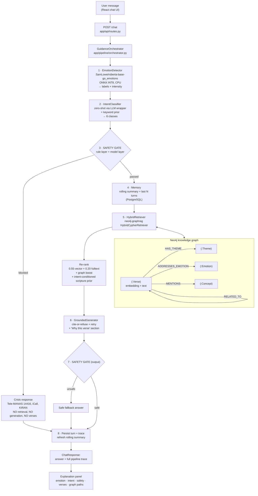

# GitaGuide

**An emotion-aware, explainable AI guidance system grounded in the Bhagavad Gita and the Arthashastra.**

A person describes a real problem — a decision at work, a loss, an anxiety they cannot put down.
GitaGuide detects the emotion behind it, classifies what kind of help is being asked for, checks
whether this is a crisis before doing anything else, retrieves verses through a knowledge graph
(vector + full-text + 1–2 hop graph traversal), and answers **only** from those verses — citing
each one by id and restating the graph path that surfaced it.

Every stage is inspectable. The frontend's explanation panel shows the detected emotion with an
intensity bar, the intent distribution, the safety verdict, the per-channel retrieval scores and
the graph paths — because the research claim of this project is explainability, not fluency.

---

## Table of contents

1. [Architecture](#architecture)
2. [Quickstart (offline, 60 seconds)](#quickstart-offline-60-seconds)
3. [Project layout](#project-layout)
4. [Running each phase](#running-each-phase)
5. [The LLM layer: NVIDIA NIM](#the-llm-layer-nvidia-nim)
6. [Going online: Neo4j, PostgreSQL, LLM keys](#going-online-neo4j-postgresql-llm-keys)
7. [Docker Compose](#docker-compose)
8. [The safety gate](#the-safety-gate)
9. [Evaluation](#evaluation)
10. [Configuration reference](#configuration-reference)
11. [Design decisions and limitations](#design-decisions-and-limitations)

---

## Architecture

Modular monolith: one FastAPI app, one container, strict module boundaries. Each pipeline stage is
a separate module with an interface and **two implementations** — a real backend and an in-process
fake — so any stage can run standalone, and the whole system runs with no services and no API keys.



**Data flow of one turn** (`app/pipeline/schemas.py` types):

```
UserTurn → EmotionResult → IntentResult → SafetyVerdict
        → MemoryContext → RetrievalTrace → GenerationResult → GuidanceResult
```

`GuidanceResult` is the whole trace. It is returned by the API, stored on the message row, and
replayable through `GET /explain/{message_id}`.

---

## Quickstart (offline, 60 seconds)

No Neo4j, no PostgreSQL, no API keys, no model downloads.

```bash
python -m venv .venv && . .venv/Scripts/activate   # Windows; use bin/activate on Linux/macOS
pip install fastapi "uvicorn[standard]" pydantic pydantic-settings httpx "SQLAlchemy>=2.0" aiosqlite pytest pytest-asyncio
cp .env.example .env                                # GITAGUIDE_MOCK_MODE=true is the default
uvicorn app.main:app --reload
```

```bash
curl -s http://localhost:8000/chat -H "Content-Type: application/json" -d "{\"message\":\"My manager took credit for my work and I am furious\"}"
```

Then the UI:

```bash
cd frontend && npm install && npm run dev     # http://localhost:5173
```

In mock mode you get: the lexicon emotion backend, the hashing embedder, the in-memory hybrid
retriever over `corpus/data/sample_corpus.json` (16 verses), the deterministic `FakeLLMProvider`,
and the in-memory repository. **The safety gate, the citation enforcement and the graph traversal
are the real implementations** — only the backing stores and the model weights are faked.

Install everything (`pip install -r requirements.txt`) when you want the real emotion model,
MiniLM embeddings, Neo4j and a hosted LLM.

---

## Project layout

```
gitaguide/
├── app/
│   ├── main.py                  FastAPI app; lifespan builds the pipeline and warms the models
│   ├── config.py                pydantic-settings; the single place that decides real vs fake
│   ├── embeddings.py            MiniLM embedder + deterministic offline hashing embedder
│   ├── api/
│   │   ├── routes.py            POST /chat, GET /explain/{id}, GET /health, GET /safety/logs
│   │   └── schemas.py           wire models (ChatRequest/ChatResponse/ExplainResponse)
│   ├── llm/
│   │   ├── base.py              LLMProvider interface, LLMResponse, FallbackLLMProvider
│   │   ├── nvidia_provider.py    NIM: retry/backoff, thinking off, think-block stripping
│   │   ├── anthropic_provider.py / openai_provider.py    lazy SDK imports
│   │   ├── fake.py              offline provider: real structure for all three LLM tasks
│   │   └── factory.py           provider selection + fallback chain
│   ├── db/
│   │   ├── models.py            SQLAlchemy: sessions, messages, safety_logs
│   │   ├── session.py           async engine / session factory / create_all
│   │   ├── repository.py        Repository interface + InMemoryRepository (no SQLAlchemy import)
│   │   └── sql_repository.py    SqlAlchemyRepository (imported lazily)
│   └── pipeline/
│       ├── schemas.py           shared stage types (the trace)
│       ├── emotion.py           1 · GoEmotions ONNX INT8 + lexicon fallback + intensity formula
│       ├── intent.py            2 · zero-shot + keyword prior (fine-tuned model = future work)
│       ├── safety.py            3 · rule layer, model layer, output layer, audit sink
│       ├── memory.py            4 · rolling summary + last N turns
│       ├── retrieval.py         5 · hybrid retrieval + intent-conditioned re-ranker
│       ├── generation.py        6 · grounded generation, citation enforcement, "Why this verse"
│       ├── orchestrator.py      chains everything; owns the safety short-circuit
│       └── textutils.py         negation/context helpers shared by safety and intent
├── corpus/
│   ├── schemas.py               Verse/Corpus schema and the id convention
│   ├── load_gita.py             gita/gita JSON → Verse[]
│   ├── build_arthashastra.py    Shamasastry (1915) prose → Book/Chapter/Sutra → AS-1.2.3
│   ├── tagging.py               weak labelling (themes / emotions / concepts)
│   └── data/sample_corpus.json  16 verses, bundled so nothing needs the network
├── kg/
│   ├── build_graph.py           corpus → Neo4j nodes/edges + vector index + full-text index
│   └── cypher_queries.py        every Cypher statement, including the hybrid retrieval tail
├── eval/
│   ├── test_safety_redteam.py   31 crisis prompts (100% recall asserted) + 15 benign controls
│   ├── retrieval_eval.py        Recall@k, MRR, nDCG@k, intent accuracy, ablation flags
│   └── gold_pairs.json          10 starter (query → verse) pairs; extend freely
├── tests/                       unit tests: emotion, safety, retrieval re-ranking, generation,
│                                orchestrator ordering, API contract
├── scripts/smoke_nvidia.py      manual: one real NIM call (never run by pytest)
├── frontend/                    Vite + React 18 + TS + Tailwind: chat + explanation panel
├── docker-compose.yml           api + neo4j + postgres + frontend
├── Dockerfile                   CPU-only API image
├── .github/workflows/ci.yml     lint · unit tests · red-team gate · retrieval metrics · FE build
├── requirements.txt  pyproject.toml  pytest.ini  .env.example
```

---

## Running each phase

Every command works offline; each has an `--offline` or `--dry-run` path where it matters.

### Phase 1 — build the corpus

```bash
python -m corpus.load_gita                      # download gita/gita JSON → corpus/data/gita.json
python -m corpus.load_gita --offline            # no network: bundled sample only
python -m corpus.build_arthashastra --input book1.txt
python -m corpus.build_arthashastra --url "https://en.wikisource.org/wiki/Arthashastra/Book_I?action=raw"
```

Both print weak-label coverage so an ineffective rule set is visible immediately.

### Phase 2 — build the knowledge graph

```bash
python -m kg.build_graph --dry-run              # writes corpus/data/graph_dump.json, no database
python -m kg.build_graph --reset                # into Neo4j: nodes, edges, vector + fulltext index
python -m kg.build_graph --corpus corpus/data/gita.json corpus/data/arthashastra.json --min-shared 2
```

### Phase 3 — run the API

```bash
uvicorn app.main:app --reload                   # http://localhost:8000/docs
curl localhost:8000/health
```

### Phase 4 — run the UI

```bash
cd frontend && npm install && npm run dev       # http://localhost:5173
```

### Phase 5 — test and evaluate

```bash
pytest                                          # everything
pytest eval/test_safety_redteam.py -v           # the gate's acceptance test
python -m eval.retrieval_eval --k 5             # Recall@5 / MRR / nDCG@5 / intent accuracy
python -m eval.retrieval_eval --k 5 --no-graph  # ablation: does graph expansion help?
python -m eval.retrieval_eval --no-intent-boost # ablation: does the scripture prior help?
ruff check app corpus kg eval tests
```

---

## The LLM layer: NVIDIA NIM

The primary generator is **NVIDIA NIM** (build.nvidia.com), which exposes an OpenAI-compatible
`/chat/completions` endpoint — so the `openai` SDK is reused with a different `base_url` and no
pipeline code knows the difference.

### Getting a key

1. Sign in at <https://build.nvidia.com>.
2. Open any model page (e.g. Nemotron 3 Super) and click **Get API Key**.
3. The key starts with `nvapi-`. Put it in `.env` and nowhere else:

```bash
echo "NVIDIA_API_KEY=nvapi-your-key-here" >> .env
```

`.env` is git-ignored. The key is read only through `app/config.py`; it appears in no source file,
no test and no documentation. `scripts/smoke_nvidia.py` prints a masked prefix only.

### Models

Slugs are verified against `GET /v1/models` (that endpoint needs no auth, so you can check any
time with `python -m scripts.smoke_nvidia --list-models --grep nemotron`).

| Role     | Setting                           | Default                             |
| -------- | --------------------------------- | ----------------------------------- |
| primary  | `GITAGUIDE_NVIDIA_MODEL`          | `nvidia/nemotron-3-super-120b-a12b` |
| fallback | `GITAGUIDE_NVIDIA_FALLBACK_MODEL` | `nvidia/nemotron-3-nano-30b-a3b`    |

`deepseek-ai/deepseek-v4-flash-0731` is a valid alternative fallback if you want a non-Nemotron
second opinion.

### Hybrid reasoning is switched off

Nemotron 3 can emit a reasoning trace, which has no place in a guidance answer. All three defences
are applied (`app/llm/nvidia_provider.py`):

1. `extra_body={"chat_template_kwargs": {"thinking": false}}`;
2. a `/no_think` directive prepended to the system prompt
   (`GITAGUIDE_NVIDIA_THINKING_DIRECTIVE`);
3. defensive stripping of `<think>…</think>`, the `<thinking>` variant, an unterminated opening tag
   left by a truncated response, and a stray closing tag.

If the endpoint ever rejects the `chat_template_kwargs` body, the provider retries immediately
without it, remembers that, and relies on (2) + (3) — so an upstream chat-template change degrades
instead of failing.

### Failover and the 40 RPM free tier

The free tier allows roughly **40 requests per minute per model** and returns HTTP 429 on burst.

```
nemotron-3-super-120b-a12b  →  nemotron-3-nano-30b-a3b  →  FakeLLMProvider
   ↑ 3 attempts, exp. backoff    ↑ same, fresh 429 bucket    ↑ always answers, still cited
     (Retry-After honoured)
```

Retries happen **inside** the provider, so a momentary rate-limit does not demote you to a weaker
model — failover only advances when a model is genuinely unavailable. Permanent errors (401/403/404)
fail fast instead of burning the retry budget. The last link is the offline provider, so a total
NVIDIA outage degrades the answer rather than the service, and the answer is still grounded and
cited.

**What 40 RPM means for user testing.** One chat turn costs **2 NIM requests** (intent
classification + generation), plus 1 more every `GITAGUIDE_MEMORY_SUMMARY_TRIGGER_TURNS` turns for
the rolling summary. That is roughly **18–20 turns per minute** across all participants on the
primary model — comfortable for a supervised session with 5–10 testers, tight if you run a large
open evaluation. Mitigations already in place: per-user rate limiting upstream of the API, the
Nano fallback with its own 429 bucket, and the intent call clamped to
`GITAGUIDE_NVIDIA_INTENT_MAX_TOKENS=100` so the cheap call stays cheap. `GET /safety/logs` and the
`llm_provider` field in every `/chat` response tell you which model actually answered, so a session
that silently fell back to Nano or to the fake provider is visible in the data.

Generation defaults: `temperature=0.6`, `max_tokens=1200`. Intent classification: `max_tokens ≤ 100`,
clamped in the provider by detecting the `TASK: intent_classification` marker — the pipeline itself
was not touched.

### Verifying it live

```bash
pip install openai
python -m scripts.smoke_nvidia                 # one real call: model, latency, first 200 chars
python -m scripts.smoke_nvidia --fallback      # same against the Nano model
python -m scripts.smoke_nvidia --show-raw      # leave thinking on, inspect the trace
python -m scripts.smoke_nvidia --list-models --grep nemotron
```

`pytest` never calls the API: `tests/test_nvidia_provider.py` injects a stub async client and
covers 429-then-success, `Retry-After`, exponential backoff, exhausted retries, fail-fast on 403,
think-block stripping, the intent clamp and the whole failover chain. `conftest.py` overrides
`NVIDIA_API_KEY` with a dummy so a real key cannot reach a test.

---

## Going online: Neo4j, PostgreSQL, LLM keys

1. Copy `.env.example` to `.env`.
2. Set `GITAGUIDE_MOCK_MODE=false`.
3. Fill in `GITAGUIDE_NEO4J_*` (AuraDB works as-is), `GITAGUIDE_POSTGRES_DSN`, and `NVIDIA_API_KEY`
   (see [The LLM layer](#the-llm-layer-nvidia-nim)). With `MOCK_MODE=false` and that key set, NIM
   becomes the default provider automatically.
4. `pip install -r requirements.txt`
5. Build the corpus and the graph (phases 1–2), then start the API.

Backends can be switched on individually — `GITAGUIDE_USE_REAL_NEO4J=true` with everything else
faked is a valid configuration, which is how retrieval is evaluated in isolation.

Degradation is deliberate: a missing Neo4j falls back to the in-memory retriever, a missing
database to the in-memory repository, and a failing LLM walks the chain
(Nemotron Super -> Nemotron Nano -> any configured extra provider -> the fake provider). The `/health` endpoint reports which backend is
actually serving.

---

## Docker Compose

```bash
docker compose up api                                  # API only, mock mode
docker compose up                                      # api + neo4j + postgres + frontend
docker compose run --rm api python -m corpus.load_gita
docker compose run --rm api python -m kg.build_graph --reset
```

| Service  | URL                     | Notes                                     |
| -------- | ----------------------- | ----------------------------------------- |
| api      | http://localhost:8000   | `/docs` for OpenAPI                       |
| frontend | http://localhost:5173   | Vite dev server, proxies to the API       |
| neo4j    | http://localhost:7474   | browser; bolt on 7687                     |
| postgres | localhost:5432          | `gitaguide` / `gitaguide`                 |

The ONNX weights live in the `model-cache` volume, so they are downloaded once.

---

## The safety gate

The gate runs **before** retrieval and generation, and again **after** generation. This is
enforced structurally in `orchestrator.handle_turn` and asserted in
`tests/test_orchestrator.py::test_safety_runs_before_retrieval_and_generation`.

| Layer      | Signal                                                                  | Effect                              |
| ---------- | ----------------------------------------------------------------------- | ----------------------------------- |
| **rule**   | regex over suicidal ideation, self-harm, harm to others, abuse, medical  | short-circuit, crisis response      |
| **model**  | `intent == crisis` above threshold, or extreme grief/fear intensity      | short-circuit, crisis response      |
| **output** | harm methods, discouraging treatment, moralising, dismissal              | replace the answer with a safe one  |

When it blocks, the pipeline returns the crisis message and **nothing else** — no retrieval, no
LLM call, no verses (asserted: `extract_verse_ids(crisis_response) == []`). The message lists
Tele-MANAS **14416**, iCall **9152987821**, AASRA, KIRAN **1800-599-0019** and **112**, plus the
Women Helpline (181) for abuse cases.

Every trigger is written to `safety_logs` with the layer, category, matched text and the
emotion/intent readings at that moment (`GET /safety/logs`), so gate precision and recall can be
reported on real traffic rather than only on the red-team suite.

**Calibration note.** Intensity is `0.75·primary + 0.15·support + lexical` (see
`emotion.compute_intensity`). The coefficients are deliberately chosen so that ordinary
bereavement stays *below* the 0.85 threshold — grief guidance is the core use case, not an
emergency — while stacked despair markers cross it. Both directions are pinned by tests.

Two suppressions keep the gate usable, and both are shared between the gate and the intent prior
so they cannot disagree: explicit negation ("I am **not** suicidal") and third-party-past framing
("my friend was suicidal last year and **recovered**"). Present-tense third-party risk still
fires — "my friend wants to die" needs the helplines either way.

---

## Evaluation

### Safety (release gate)

`pytest eval/test_safety_redteam.py` — 31 crisis prompts must all be blocked (recall asserted at
exactly 1.0), 15 benign prompts must all pass, plus output-layer and logging checks. Three
documented gaps (code-mixed Hindi, heavy euphemism) are `xfail`ed rather than hidden: they are
limitations to report. This job is a required check in CI.

### Retrieval

`python -m eval.retrieval_eval` reports Recall@k, Precision@k, MRR, nDCG@k, hit rate and intent
accuracy over `eval/gold_pairs.json`, and prints which backend and embedder produced the numbers.

Offline baseline (hashing embedder, 16-verse sample corpus, k=5) — **a floor, not a result**:

| Configuration            | Recall@5 | MRR   | nDCG@5 |
| ------------------------ | -------- | ----- | ------ |
| full hybrid              | 0.717    | 0.562 | 0.553  |
| `--no-graph` (ablation)  | 0.567    | 0.437 | 0.460  |

Graph expansion is worth ~15 points of Recall@5 even on this tiny corpus, which is the retrieval
argument of the project. Re-run with `GITAGUIDE_MOCK_MODE=false` (real MiniLM + Neo4j + the full
corpus) for numbers worth putting in a dissertation.

---

## Configuration reference

All settings are read by `app/config.py` from `.env` with the `GITAGUIDE_` prefix. Secrets are
never hardcoded and `.env` is git-ignored. The knobs that change research behaviour:

| Variable                                   | Default | What it controls                                        |
| ------------------------------------------ | ------- | ------------------------------------------------------- |
| `GITAGUIDE_MOCK_MODE`                      | `true`  | master offline switch (all fakes)                       |
| `GITAGUIDE_SAFETY_INTENSITY_THRESHOLD`     | `0.85`  | intensity at which grief/fear alone trips the gate      |
| `GITAGUIDE_SAFETY_CRISIS_INTENT_THRESHOLD` | `0.5`   | crisis-intent confidence needed to trip the gate        |
| `GITAGUIDE_SCRIPTURE_INTENT_BOOST`         | `0.25`  | strength of the intent-conditioned scripture prior      |
| `GITAGUIDE_GRAPH_PATH_BOOST`               | `0.15`  | weight of the graph channel in the fused score          |
| `GITAGUIDE_GRAPH_EXPANSION_HOPS`           | `2`     | 0 disables graph expansion, 1 = emotion hop only        |
| `GITAGUIDE_RETRIEVAL_TOP_K`                | `5`     | verses handed to the generator                          |
| `GITAGUIDE_MEMORY_LAST_N_TURNS`            | `6`     | verbatim turns in the prompt                            |
| `GITAGUIDE_MEMORY_SUMMARY_TRIGGER_TURNS`   | `8`     | how often the rolling summary is refreshed              |
| `GITAGUIDE_LLM_PROVIDER`                   | `fake`  | `nvidia` \| `anthropic` \| `openai` \| `fake`            |
| `GITAGUIDE_LLM_FALLBACK_PROVIDER`          | unset   | extra provider between NIM and the fake                 |
| `NVIDIA_API_KEY`                           | unset   | the `nvapi-` key; its presence makes NIM the default    |
| `GITAGUIDE_NVIDIA_MODEL`                   | Super 120B | primary NIM model slug                               |
| `GITAGUIDE_NVIDIA_FALLBACK_MODEL`          | Nano 30B | second NIM model (separate 429 bucket)                 |
| `GITAGUIDE_NVIDIA_MAX_RETRIES`             | `3`     | in-provider attempts on 429/5xx before failover         |
| `GITAGUIDE_NVIDIA_INTENT_MAX_TOKENS`       | `100`   | ceiling for the intent-classification call              |
| `GITAGUIDE_NVIDIA_DISABLE_THINKING`        | `true`  | suppress the Nemotron reasoning trace                   |

---

## Design decisions and limitations

**Decisions**

- **Modular monolith, not microservices.** One process, strict module boundaries, every stage
  behind an interface. A final-year project needs to be readable and reproducible before it needs
  to be distributed.
- **NIM behind the same interface.** NVIDIA is a `LLMProvider` like any other, so switching to
  Anthropic or OpenAI for a comparison chapter is an env-var change, and the retry/rate-limit
  handling lives in the provider rather than leaking into the pipeline.
- **Fakes, not mocks.** `FakeLLMProvider`, `HashingEmbedder`, `InMemoryHybridRetriever` and
  `InMemoryRepository` are working implementations of the same interfaces, so offline runs
  exercise the real safety, grounding and ranking code.
- **Citations enforced mechanically.** The generator diffs cited ids against retrieved ids, retries
  once with a corrective instruction, and falls back to a template answer composed from the
  retrieved verses. An ungrounded answer cannot reach the user.
- **Graph paths, not attention weights.** The explanation is the traversal that actually produced
  the candidate, which is why "Why this verse" restates node/relationship chains.

**Limitations (stated, not hidden)**

- Themes and emotions are **weak labels** from keyword rules over English translations
  (`corpus/tagging.py`). Metaphor is missed and polysemy mistagged. Planned: a ~200-verse
  human-annotated subset with rule-vs-human agreement (Cohen's kappa).
- Arthashastra sutra numbers are **positional** (paragraph index within a chapter), not
  philological. They are stable and citable, but they are not a standard critical edition's
  numbering.
- Intent classification is **zero-shot + keyword prior**. `FineTunedIntentClassifier` is an
  explicit stub: labelling ~2k turns and fine-tuning `distilroberta-base` (then ONNX INT8, like the
  emotion model) is future work, with macro-F1 against this baseline as the comparison.
- The gate's rule layer is **English-only**. Code-mixed Hindi/Hinglish is a known gap, tracked as
  `xfail` cases in the red-team suite.
- The bundled sample corpus is 16 verses — enough to develop and test against, not to evaluate on.
  Run phases 1–2 for the full corpus before reporting numbers.
- `Base.metadata.create_all` is used instead of migrations; Alembic is listed in
  `requirements.txt` but not yet wired.

**Not a clinical tool.** GitaGuide is a research prototype. It is not a therapist, doctor or
lawyer, it says so in the UI, and the safety gate exists precisely because the failure mode of a
guidance system is not a bad answer but a harmful one.
